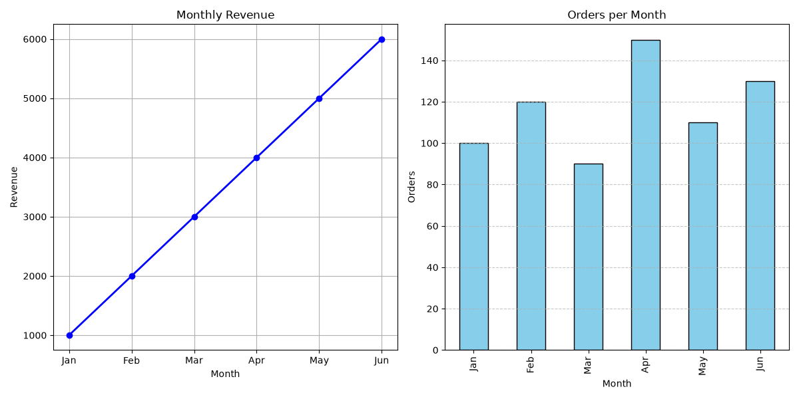

# 🚀 Python Full Stack Using AI: 90-Hour Training


## 🎓 Training Overview

I have successfully completed a **90-hour hands-on training in Python Full Stack Development Using AI** at **Fuel Training**. This repository contains my daily practice work, assignments, mini projects and trained models from the program.

| Detail | Info |
|--------|------|
| **Program** | Python Full Stack Using AI |
| **Duration** | 90 Hours |
| **Institute** | Fuel Training |
| **Status** | ✅ Completed |
| **Learner** | Ajay Gaware |

---

## 📚 What I Learned

- **Python Fundamentals**: variables, data types, loops, functions, file handling
- **Data Analysis**: cleaning and analysing data with Pandas and NumPy
- **Data Visualization**: charts and dashboards with Matplotlib and Seaborn
- **Machine Learning**: building, training and saving prediction models
- **Deep Learning**: neural network model for digit recognition with Keras
- **Full Stack Basics**: HTML, CSS, JavaScript, [Flask / Django], [MySQL / SQLite]
- **AI-Assisted Development**: using AI tools to write, debug and improve code
- **Version Control**: Git and GitHub workflow

---

## 🛠 Tech Stack

| Area | Tools |
|------|-------|
| Language | Python 3 |
| Data | Pandas, NumPy |
| Visualization | Matplotlib, Seaborn |
| Machine Learning | scikit-learn, Keras / TensorFlow |
| Web | HTML, CSS, JavaScript, [Flask / Django] |
| Database | [MySQL / SQLite] |
| Tools | VS Code, Jupyter Notebook, Git, GitHub |

---

## 📂 Repository Structure

```
Fuel-Training-Python-Full-Stack-Using-AI/
│
├── day3.py – day8.py               # Python practice scripts
├── day6.ipynb – day9.ipynb         # Daily notebooks
├── day7questions.ipynb             # Practice questions
├── day8question.ipynb              # Practice questions
├── day8rawdata.ipynb               # Raw data analysis
├── day10.ipynb                     # Day 10 notebook
├── day10miniproject.ipynb          # Mini Project 1
├── day11.ipynb                     # Day 11 notebook
├── day11miniproject.ipynb          # Mini Project 2
├── day14.ipynb                     # Day 14 notebook
├── marks_model.pkl                 # Trained marks prediction model
├── marks_multi.pkl                 # Multi-output marks model
├── pass_model.pkl                  # Pass/fail prediction model
├── digits.keras                    # Trained digit recognition model
├── dashboard.png                   # Dashboard output
├── names.txt                       # Sample data file
└── README.md
```

---

## 🧪 Mini Projects

| Project | Description | File |
|---------|-------------|------|
| **Mini Project 1** | [Short description, e.g. data analysis and dashboard] | `day10miniproject.ipynb` |
| **Mini Project 2** | [Short description, e.g. marks / pass prediction using ML] | `day11miniproject.ipynb` |
| **Digit Recognition** | Neural network trained to recognise handwritten digits | `digits.keras` |

---

## 🖼 Dashboard Preview



---

## ⚙️ How to Run

1. **Clone the repository**
   ```bash
   git clone https://github.com/ajayy3/Fuel-Training-Python-Full-Stack-Using-AI-.git
   cd Fuel-Training-Python-Full-Stack-Using-AI-
   ```

2. **Create and activate a virtual environment**
   ```bash
   python -m venv .venv
   .venv\Scripts\activate
   ```

3. **Install the libraries**
   ```bash
   pip install pandas numpy matplotlib seaborn scikit-learn tensorflow jupyter
   ```

4. **Open the notebooks**
   ```bash
   jupyter notebook
   ```
   Or open any `.ipynb` file directly in VS Code.

---

## 🏆 Key Achievements

- ✅ Completed the full 90-hour training program
- ✅ Built and saved multiple machine learning models
- ✅ Created data dashboards and visualizations
- ✅ Completed hands-on mini projects
- ✅ Maintained daily work on GitHub

---

## 🔮 Next Steps

- Build a complete full stack project with a trained AI model
- Deploy a project online
- Add REST APIs and a database

---

## 👨‍💻 Author

**Ajay Gaware**
- GitHub: [@ajayy3](https://github.com/ajayy3)
- Email: ajaygaware2004@gmail.com
- LinkedIn: [ ]


⭐ If you found this repository useful, please give it a star!